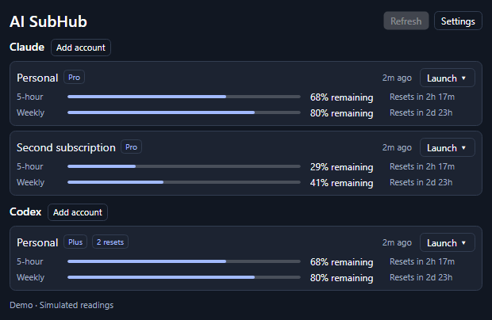
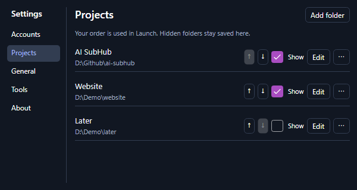

# AI SubHub

**Your AI subscriptions, at a glance.**

A compact desktop app for checking **Claude and Codex usage across multiple accounts**, then launching the right CLI profile in the right project folder. Lives in your Windows tray or macOS menu bar. Free, open source, and local.

[Downloads](https://github.com/wellbrained/ai-subhub/releases) · [Report a bug](https://github.com/wellbrained/ai-subhub/issues) · [Build from source](#build-from-source) · [MIT license](LICENSE)



*Windows screenshot with simulated accounts and usage. No real account details are shown.*

## What it does

- **See your allowances.** Five-hour, weekly, and other provider-reported windows, with reset countdowns and clear stale/unavailable states.
- **Manage multiple accounts.** Connect separate CLI profiles, rename them, and choose their order. Plan tags and signed-in email are shown when available.
- **Launch by account and project.** Choose **Launch → Project → target** to start a CLI in a terminal, open VS Code, or open the matching desktop app.
- **Keep projects organized.** Save local folders, set their order, and hide inactive projects without removing them.
- **Make it yours.** Switch between **% remaining / % used**, choose dark/light/system appearance, adjust refresh frequency, and opt into startup at login.
- **Check from the tray.** Hover for a compact usage summary; close the window to keep it running in the background.

<details>
<summary>Project ordering and visibility</summary>



*Demo folders. Hidden projects stay saved and can be shown again at any time.*

</details>

## Get started

AI SubHub is early-stage software. Windows is the tested platform; the macOS port is available as an experimental test build.

| Platform | Availability |
| --- | --- |
| Windows x64 | [Download portable ZIP](https://github.com/wellbrained/ai-subhub/releases/download/v0.13.0/AI-SubHub-0.13.0-win-x64.zip) |
| macOS 15+ · Apple Silicon | [Download unsigned test ZIP](https://github.com/wellbrained/ai-subhub/releases/download/v0.13.0/AI-SubHub-0.13.0-osx-arm64-unsigned.zip) |
| macOS 15+ · Intel | [Download unsigned test ZIP](https://github.com/wellbrained/ai-subhub/releases/download/v0.13.0/AI-SubHub-0.13.0-osx-x64-unsigned.zip) |

Mac builds have not yet been validated on a real Mac and have no Developer ID signature or notarization. macOS may require explicit approval in **Privacy & Security**. See the [Mac guide and testing checklist](docs/features/macos.md). Linux is not supported yet.

### Connect your accounts

Install **Claude Code** and/or the **Codex CLI** for the providers you want to use. AI SubHub uses their subscription logins; it does not install or update the CLIs.

1. Open AI SubHub. On Windows, run `AI.SubHub.exe` from the portable build. On Mac, extract the ZIP and move `AI SubHub.app` to Applications.
2. Choose **Add account** beside a provider. Give it a name and select its existing CLI profile folder, or choose **Create a separate profile** for another login.
3. Use **Settings → Accounts → ⋯ → Sign in** if needed. Finish sign-in in the terminal. Current source builds refresh that account automatically after success; older test builds may need a manual refresh.
4. Add local folders in **Settings → Projects**. Use **↑ / ↓** to reorder them and **Show** to control which ones appear in Launch.
5. On an account row, choose **Launch → Project → target**.

Default profiles are `~/.claude` and `~/.codex` (`%USERPROFILE%` is your home folder on Windows). Executables are detected automatically; set a custom path in **Settings → Tools** if needed.

CLI profile selection applies to terminal launches. Desktop apps and IDE extensions use their own logins. Claude Desktop can open a local Code folder; Codex Desktop currently asks you to choose the folder inside the app. **Claude chat Projects are separate from local folders and are not synced.**

Close the main window to keep monitoring; use the tray/menu-bar menu to exit. Startup is opt-in under **Settings → General**. Removing an account disconnects it from AI SubHub; its CLI login, history, and files stay in place.

## How usage and credentials work

| Provider | Usage source | Authentication |
| --- | --- | --- |
| Claude | Authenticated, **undocumented** OAuth usage endpoint | Selected CLI profile's credentials on Windows; profile-specific Keychain entry with selected-profile file fallback on Mac |
| Codex | Official CLI app-server account and rate-limit reads | Managed by the Codex CLI for the selected profile |

Usage requests go directly to the providers. There is **no AI SubHub account, backend, or telemetry**. Claude's access token is read into memory for the usage request; AI SubHub does not copy credentials into its settings or implement token refresh. The CLIs retain their own settings and privacy policies.

Settings contain account labels, profile paths, saved project folders, preferences, and cached usage:

- Windows: `%LOCALAPPDATA%\AI SubHub\settings.json`
- macOS: `~/Library/Application Support/AI SubHub/settings.json`

Refresh defaults to five minutes. Errors back off, and provider cooldowns also apply to manual refresh. Failed reads keep the last snapshot visibly stale; a reset countdown never refills an allowance without a new reading.

Claude's unofficial usage connection can break when the provider changes it. API-key billing is outside the subscription monitor's scope. Plan tags reflect available login metadata, not a live billing or renewal check. Manual-reset counts appear only when supplied by the provider; AI SubHub does not redeem resets or buy credits.

## Build from source

Requires the **.NET 10 SDK**. Downloaded/self-contained builds do not require a separate .NET runtime.

```powershell
git clone https://github.com/wellbrained/ai-subhub.git
cd ai-subhub
./build.ps1                 # Release build and tests
./build.ps1 -Task Publish   # Portable Windows x64 app and ZIP
```

Windows output is written to `artifacts/AI-SubHub-<version>-win-x64/` and the adjacent ZIP.

For Mac builds:

```bash
# On a Mac with the .NET 10 SDK:
bash scripts/build-macos.sh
```

Or cross-publish both Mac architectures from Windows with PowerShell and Python 3:

```powershell
./build.ps1 -Task PublishMac -PythonExecutable python
```

The native Mac script applies a local ad-hoc signature for testing; it does not provide Developer ID signing or notarization.

To explore the UI with synthetic data and no provider requests:

```powershell
dotnet run --project src/Hub.App -- --demo
```

Built with **C# / .NET 10 and Avalonia 12**. Provider adapters, parsing, and storage live in `Hub.Core`; desktop lifecycle and UI live in `Hub.App`. See the [behavior guide](docs/features/windows-mvp.md) and [validation notes](docs/validation.md) for details.

## Contributing

Bug reports and focused pull requests are welcome. Include your OS, provider, CLI version, reproduction steps, and a redacted error message. Keep tokens, credential files, and private profile contents out of issues and screenshots. Run `./build.ps1` before submitting code changes.

AI SubHub is an independent project and is not affiliated with Anthropic or OpenAI. Licensed under [MIT](LICENSE).
