# AI SubHub

**Your AI subscriptions at a glance, from the Windows tray.**

AI SubHub shows the usage limits of all your **Claude Code** and **Codex** accounts in one place: the 5-hour and weekly windows, how much is left and when each one resets. **GitHub Copilot**, **Cursor** and **Google Antigravity** logins on your PC show their limits too. It also starts the right CLI profile in the right project folder. Free, open source and local, with no account, no backend and no telemetry.

[Download](https://github.com/wellbrained/ai-subhub/releases/latest) · [Changelog](CHANGELOG.md) · [Report a bug](https://github.com/wellbrained/ai-subhub/issues) · [Build from source](#build-from-source) · [MIT license](LICENSE)

<p align="center">
  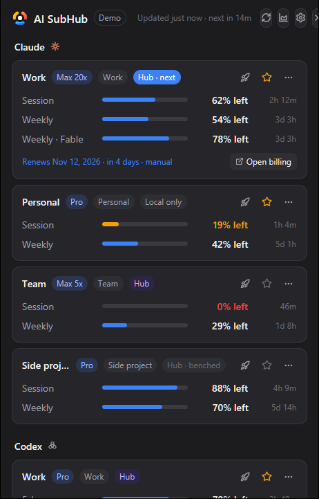
</p>

**Right on the taskbar, next to the tray.** Your favourite accounts sit as small badges beside the clock, with their 5-hour and weekly bars always in view. Hover one for the details, including model limits such as Claude's weekly Fable limit; click it to open the popover.

<p align="center">
  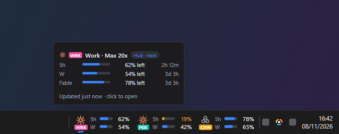
</p>

*All screenshots use demo mode's made-up accounts and usage.*

## What it does

- **All limits in one popover.** Click the tray icon for one card per account, with a bar per window, % left (or % used) and the reset time. Stale readings, cooldowns and sign-in problems are shown, not hidden.
- **Usage on the taskbar.** Small badges next to the tray show up to five accounts at all times (favourites, the one in focus, or automatic), on the main or every taskbar. Hover one for all its limits; drag it to move it. You can switch it off in Appearance.
- **Several accounts per provider.** Each CLI profile is its own account, with a name, a coloured tag, a plan badge and an optional group. SubHub finds the profiles on your PC and offers to add them.
- **More than Claude and Codex.** GitHub Copilot (monthly premium requests or AI credits), Cursor (the plan's weekly or monthly usage, Auto and API) and Google Antigravity (5-hour and weekly limits per model group) show up next to them, read from the login already on your PC. For now these three show limits only.
- **Launch by account and project.** The rocket on a card opens a project folder in Windows Terminal, PowerShell, VS Code or the provider's desktop app, signed in as that account.
- **Insights.** Whether your plans fit how you work (too big, at the limit, unused), how often you waited for a 5-hour reset while another account was free, upcoming renewals, and where your usage goes by task, project and model.
- **Warm-up (optional).** Start your 5-hour windows early at a time you choose, so the first reset comes when you usually run out. SubHub suggests a time from your own days; nothing runs until you set it up.
- **Heads-up before you run out (optional).** A notification about 15 minutes before an account's 5-hour window runs out, when another account still has a fresh one.
- **Usage statistics.** Tokens and an API cost estimate per day, model and provider, read from the CLIs' local session logs, plus a live board of all limits.
- **Renewal reminders.** Optionally enter an account's monthly renewal or access end date to get a reminder 7 and 3 days before.
- **Hub support (optional).** If you run a [CLIProxyAPI](https://github.com/router-for-me/CLIProxyAPI) hub, SubHub lists its logins by itself, lets you remove one or sign in a new Claude or Codex login there, and can steer new hub threads to the account whose weekly limit expires soonest, or to one you pick.
- **Updates itself** from GitHub Releases, automatically or when you say so, and shows short patch notes afterwards.

## The main window

Open **Statistics** or **Settings** from the tray menu or the popover. Both open the same window, with a sidebar of three groups. Everything in Insights and Data is read from the session logs Claude Code and Codex write on your PC and from SubHub's own readings, so it works without the hub and sends nothing anywhere.

**Insights**

- **Overview:** one sentence on how much of your plans you use, four key numbers, the most useful tip, and a short answer per topic that opens its page.
- **Plans & renewals:** per account the plan, current and weekly usage, 5-hour limit hits and whether the plan fits (with what a smaller or bigger plan would mean), then upcoming renewals and end dates.
- **Usage patterns:** how 5-hour windows and resets work, one of your days as it went and with an earlier start, the last 7 days of windows per account, the Warm-up setup, and where your usage goes by task (main threads and subagents), project, thread and model.

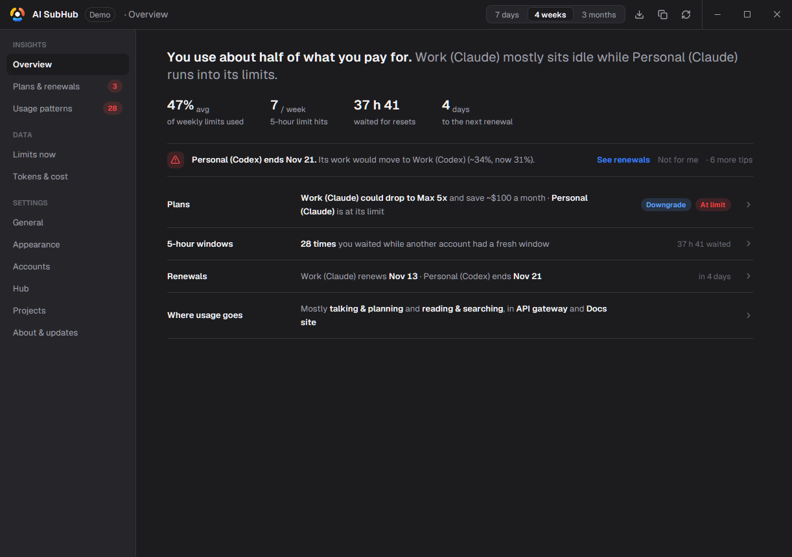

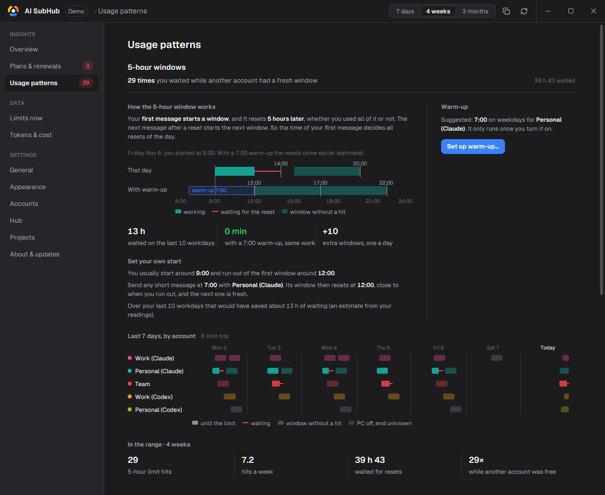

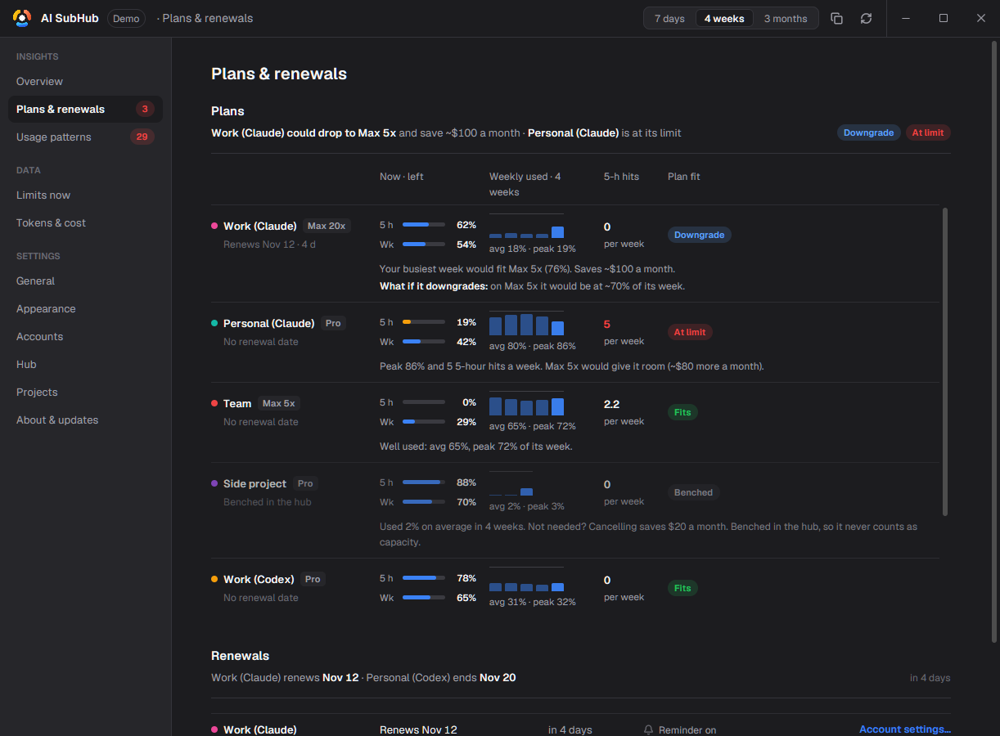

**Data**

- **Limits now:** a live board of every account's windows (5-hour, weekly, monthly and model limits), with % left, reset countdowns and pace. It is useful for picking the account with the most room before a long task.
- **Tokens & cost:** work tokens (input and output) and an API cost estimate for the past 24 hours or 7, 30 or 90 days, split into input, output and cache, with a daily chart per provider and a table per model. The estimate uses public list prices and shows what the same work would cost on the API, not what you pay for your plan.

| | |
| --- | --- |
| 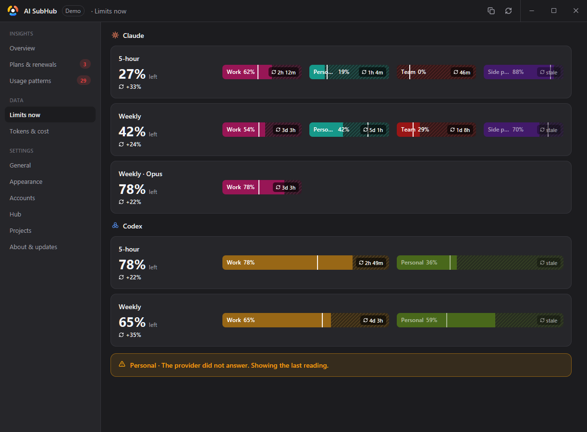 | 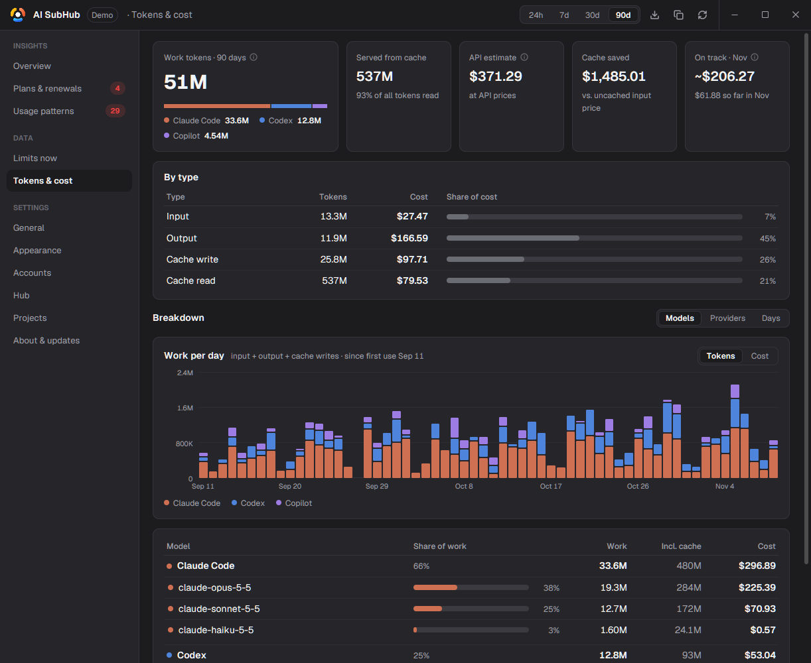 |

<p align="center">
  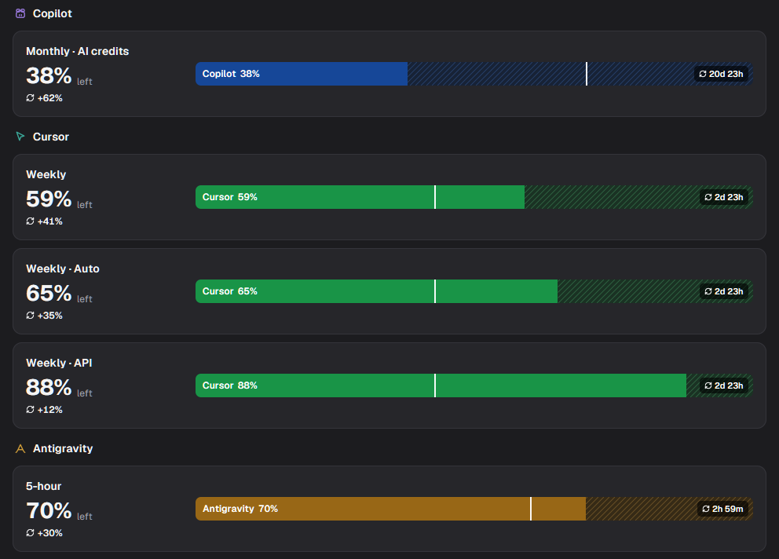
</p>

**Export** (the download button in the title bar):

- **Usage report (PDF):** the Overview as a 2-3 page report for the chosen range: the verdict, key numbers, every account's plan fit, renewals, tips, and where usage goes by model, project and kind of work. Good to keep or to share.
- **Tokens & cost (CSV):** tokens and the API estimate per day, provider and model.
- **Limit history (CSV):** every reading SubHub saved: time, account, window, % used and reset time.

**Settings**

- **General:** refresh interval, Warm-up status, the run-out heads-up, what the close button does, Start with Windows, and (under Advanced) the sign-in terminal and CLI paths.
- **Appearance:** theme, accent colour, % left or % used, plan badges, emails, and the taskbar badges (which accounts, left or right).
- **Accounts:** all accounts by provider with their source and status. Open an account to rename it, change its tag colour and group, show it on the taskbar, set its renewal date, or sign in again. **Add accounts** lists the CLI profiles and the Copilot, Cursor and Antigravity logins found on your PC.
- **Hub:** connect a CLIProxyAPI hub, manage its logins (remove one, or sign in a new Claude or Codex login in your browser) and turn steering for new threads on or off. A login removed from the hub stays in SubHub as a normal CLI account if it has a profile on your PC.
- **Projects:** the folders that appear in every card's Launch menu, in your order, with the option to hide some.
- **About & updates:** version, update mode (automatic or manual) and the patch notes.

| | |
| --- | --- |
| 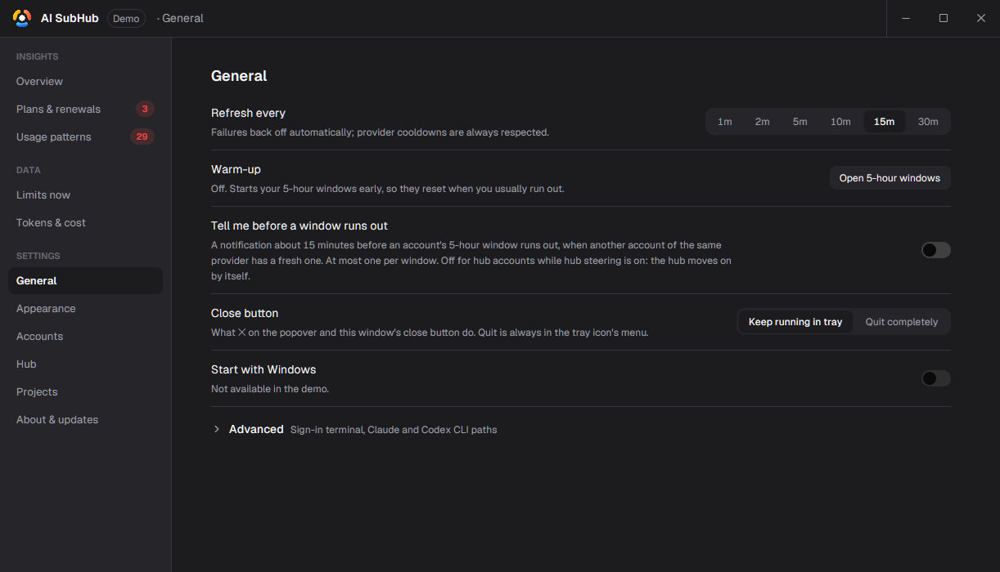 | 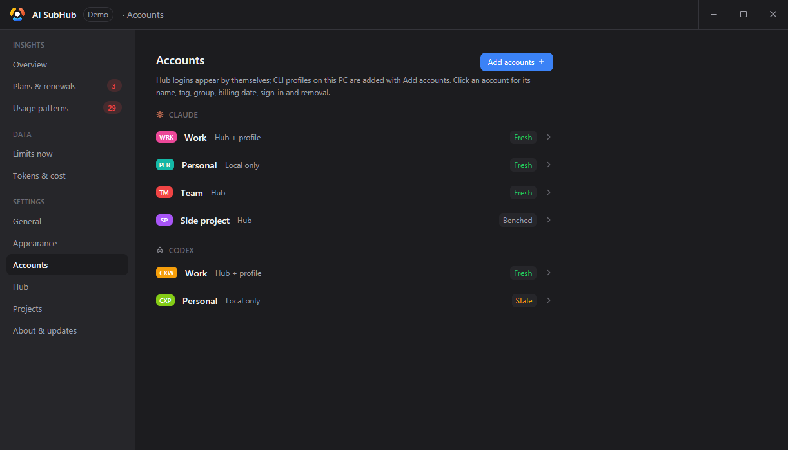 |
| 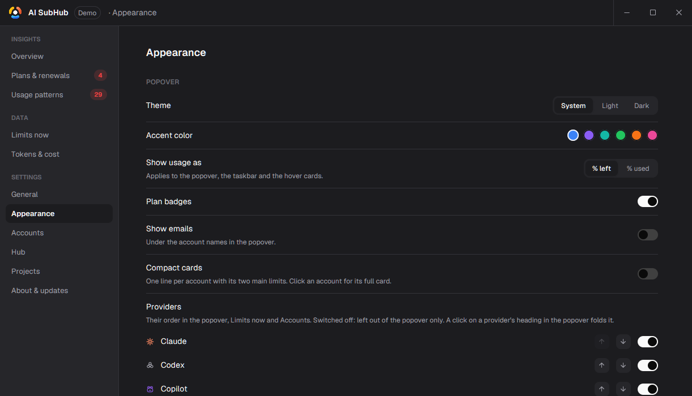 | 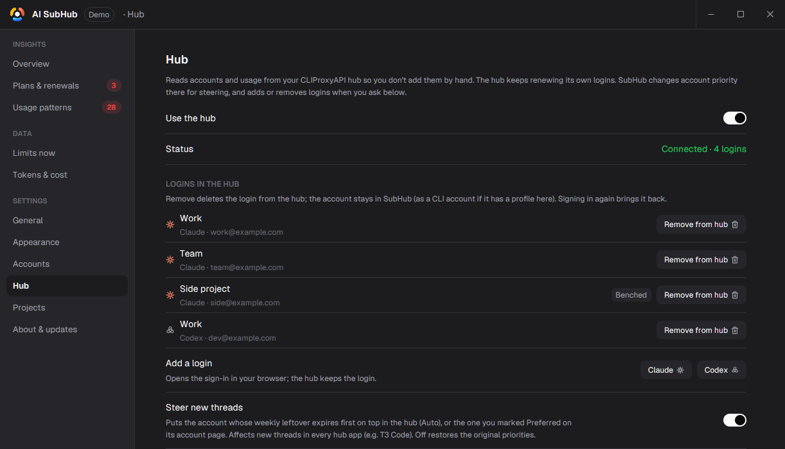 |

## Get started

Requires **Windows 11** (x64); Windows 10 may work but is untested. macOS and Linux are not supported yet.

1. Download `ai-subhub.exe` from the [latest release](https://github.com/wellbrained/ai-subhub/releases/latest) and put it in a folder you keep, for example `%LOCALAPPDATA%\Programs\AI SubHub`. There is no installer, and updates replace the exe in place.
2. Start it. The exe is not code-signed, so Windows SmartScreen may warn you the first time: **More info → Run anyway**.
3. On the first start, the window opens on **Add accounts** with the Claude Code and Codex profiles found on your PC (`~\.claude*`, `~\.codex*`, `CLAUDE_CONFIG_DIR`, `CODEX_HOME`), plus a Copilot, Cursor or Antigravity login if you have one. Tick the ones you want. A profile in another place can be added with **Choose a folder manually**.
4. Click the tray icon. If an account says *Sign in needed*, use **Sign in** on its card or settings page; the CLI login opens in a terminal, and the account refreshes when it is done.

**Start with Windows** is opt-in (Settings → General). Closing a window keeps SubHub in the tray; quit it from the tray menu.

### Try it without your accounts

```powershell
ai-subhub.exe --demo
```

Demo mode runs the real app on made-up accounts, usage and projects in a temporary folder. It runs next to your normal SubHub and never touches your accounts, hub, settings or startup entry.

## How usage and credentials work

| Provider | Where usage comes from | Login |
| --- | --- | --- |
| Claude Code | Claude's OAuth usage endpoint (**undocumented**), with the profile's own token | Managed by Claude Code; SubHub only reads the token into memory for the request |
| Codex | The Codex CLI's own app-server (account and rate-limit reads only, no model calls) | Managed by the Codex CLI |
| GitHub Copilot | GitHub's Copilot quota endpoint (**undocumented**): monthly premium requests or AI credits | The Copilot CLI's GitHub login (or `gh`); SubHub sends it only to api.github.com |
| Cursor | Cursor's usage endpoint (**unofficial**): the plan's weekly or monthly usage, Auto and API pools | The Cursor CLI's login (`cursor-agent login`); never refreshed by SubHub |
| Google Antigravity | The official `agy` CLI's `/usage` command | Managed by `agy`; SubHub never touches its token (Google's terms forbid third-party use) |
| CLIProxyAPI hub (optional) | The hub's management API; the hub adds the token itself | Your hub's management key, stored in Windows Credential Manager |

- Requests go straight to the providers or your own hub. There is **no SubHub server and no telemetry**. The only other requests are the update check (GitHub) and a public model price list ([LiteLLM](https://github.com/BerriAI/litellm)) for cost estimates.
- SubHub never refreshes, copies or saves provider tokens. Its settings (`%LOCALAPPDATA%\AI SubHub\settings.json`) hold account names, profile paths, project folders, preferences and the last readings.
- A failed reading keeps the last one, marked stale. Missing data is shown as unavailable, never as 0%, and a passed reset time never refills a bar without a new reading.
- Errors back off, and provider rate limits are respected, also by manual refresh.
- Claude's, Copilot's and Cursor's usage endpoints are unofficial and can change without notice. Copilot, Cursor and Antigravity show limits only (no Tokens & cost, no hub, no Launch), and were built from their documented shapes without a real account to test with yet. API-key billing is outside the scope of a subscription monitor.

## Build from source

Requires the [Rust toolchain](https://rustup.rs/) (stable, edition 2024) on Windows.

```powershell
git clone https://github.com/wellbrained/ai-subhub.git
cd ai-subhub
cargo test --workspace
cargo run -p subhub-app -- --demo      # the app on made-up data
cargo build --release                  # target\release\ai-subhub.exe
```

Built with Rust and [GPUI](https://www.gpui.rs/) (via `gpui-pre` and `gpui-component`). Provider readers, settings and the rules live in `crates/subhub-core`; the tray, windows and UI in `crates/subhub-app`. Behaviour details: [docs/features/app.md](docs/features/app.md).

## Contributing

Bug reports and focused pull requests are welcome. Please include your Windows version, the provider, the CLI version, steps to reproduce and a redacted error message. Keep tokens, credential files and private profile contents out of issues and screenshots (demo mode helps). Run `cargo test --workspace` and `cargo clippy --workspace --all-targets` before submitting.

The app's font is [Geist](https://github.com/vercel/geist-font) by Vercel, under the SIL Open Font License 1.1 ([crates/subhub-app/assets/fonts/OFL.txt](crates/subhub-app/assets/fonts/OFL.txt)).

AI SubHub is an independent project and is not affiliated with Anthropic, OpenAI, GitHub, Cursor (Anysphere) or Google.
